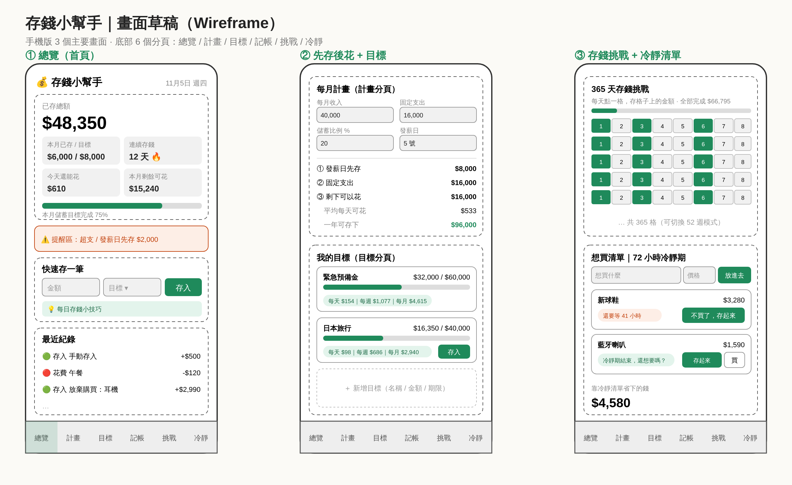

# 存錢小幫手

一個打開瀏覽器就能用的存錢系統（單一 HTML 檔，不需安裝、不需伺服器）。右上角可切換淺色 / 深色。

用法：
- 線上版（Claude Artifact）：資料存到你的帳號，只有你看得到，換裝置也找得到。
- 本機：直接用瀏覽器打開 `savings/index.html`，資料存在這台裝置的瀏覽器。
- 兩種都可匯出 / 匯入 JSON 備份。

## 功能與存錢原理

| 分頁 | 做什麼 | 為什麼有效 |
| --- | --- | --- |
| 總覽 | 總存款、本月進度、連續天數、今天還能花多少、提醒 | 每天看到數字，有回饋才持續 |
| 計畫 | 輸入收入 / 固定支出 / 儲蓄比例 / 發薪日，算出每月先存、可花、每日額度 | 「先存後花」：發薪日先把錢轉走 |
| 目標 | 多個目標 + 期限，自動算每天 / 每週 / 每月要存多少 | 大目標拆成小金額 |
| 記帳 | 記花費、分類統計、超支警告 | 花太多會立刻看到 |
| 挑戰 | 365 天（1~365 元）或 52 週挑戰，點格子即存入 | 遊戲化，降低開始門檻 |
| 冷靜 | 想買的東西先等 72 小時，放棄就把錢存進目標 | 擋掉衝動消費並把省下的錢變存款 |

> 這個 App 負責「計畫與追蹤」；真正讓錢存下來的關鍵，是在銀行設定發薪日自動轉帳到另一個（不綁卡的）儲蓄帳戶，金額照「計畫」頁算出的數字。
